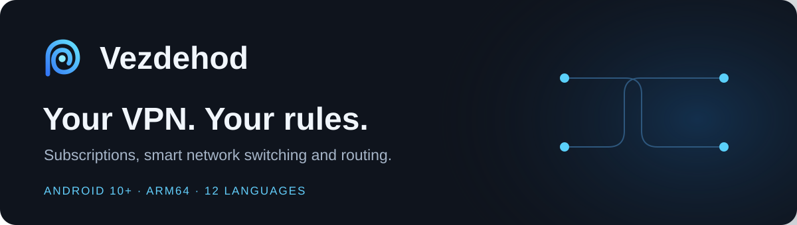
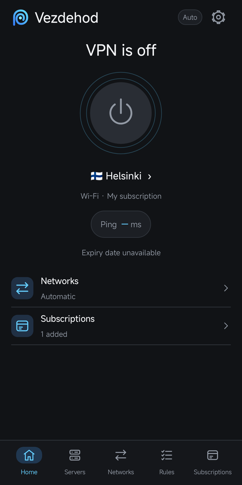
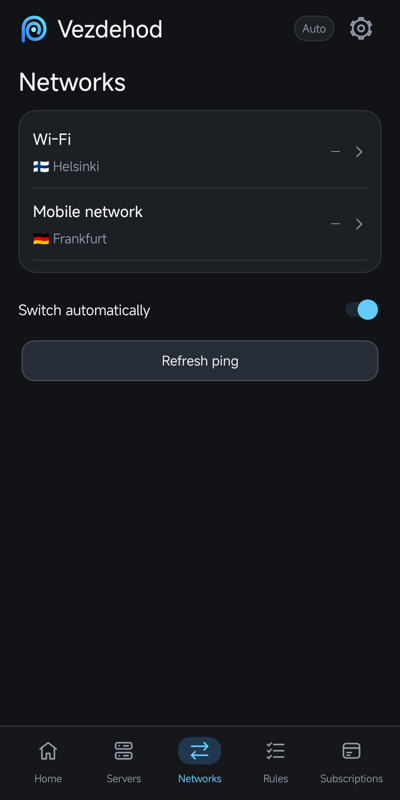
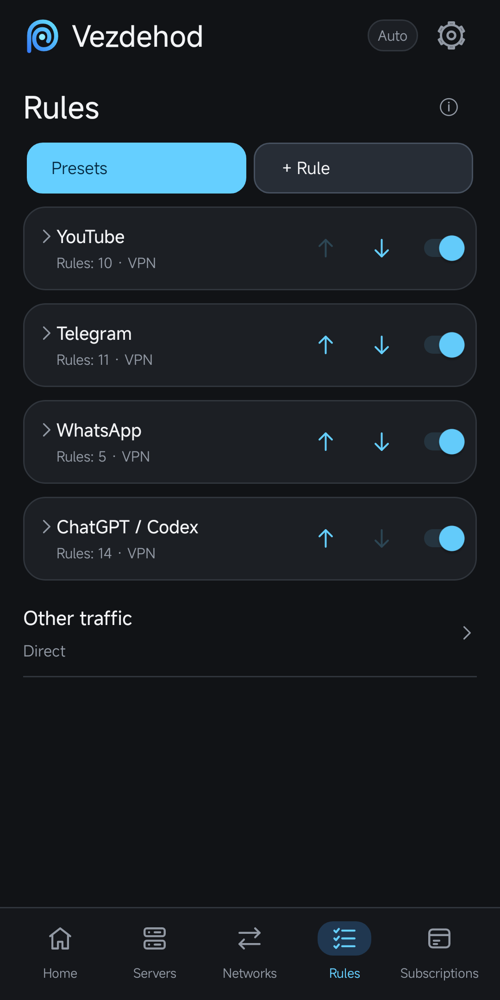

  

  

  <strong>v0.2.17</strong> · Android 10 or later · ARM64 · 24.8 MB 
  <a href="https://github.com/blackmamba161/vezdehod/releases/latest">Latest release</a> ·
  <a href="#get-started">Installation</a> ·
  <a href="https://github.com/blackmamba161/vezdehod/issues">Help &amp; feedback</a>

**Choose a server for Wi-Fi, another for mobile data, and let Vezdehod switch between them.** Keep your subscriptions, connection checks and routing rules in one app.

Bring your own VPN subscription or server configuration. Vezdehod does not include a VPN service.

## A look inside

<table>
  <tr>
    <th>One-tap connection</th>
    <th>Wi-Fi &amp; mobile</th>
    <th>Rules by service</th>
  </tr>
  <tr>
    <td></td>
    <td></td>
    <td></td>
  </tr>
</table>

Actual app interface with demonstration data. No servers or subscriptions are included.

## What you can do

| | |
| --- | --- |
| **Switch with your network** | Assign different servers to Wi-Fi and mobile data. Switch automatically when the connection changes. |
| **Choose what uses the VPN** | Route apps and domains through the VPN, directly, or block them. Start with service presets and adjust the rules. |
| **Keep subscriptions together** | Add a link from the clipboard, scan a QR code, or import a supported configuration. See usage and expiry when supplied by your provider. Use the ⋮ menu to copy, share, edit or remove a subscription. |
| **Check before connecting** | Test server latency individually or in a batch. Connection status is verified before the app reports a successful connection. |
| **Control DNS** | Use automatic DNS or choose your own primary and backup resolvers in Settings → Connection → DNS. Test the settings before saving. |
| **Make it yours** | Choose the appearance and follow the device language, or select from 12 interface languages. |
| **Stay up to date** | Check for updates manually or automatically. Download and install when you are ready. |

## Get started

1. **Download the APK** using the button above and open it on your Android phone.
2. **Confirm installation.** If Android asks, allow installation from the browser or file manager you used.
3. **Add your subscription.** Open **Subscriptions → +** and use a link or QR code from your provider.
4. **Choose your servers** in **Networks**, then tap the connection button on **Home**. Accept Android's VPN permission on first use.

Already installed? Install the new APK **over your existing version** to keep your subscriptions and rules.

## Questions

<strong>Which phones are supported?</strong>

Android 10 or later with an ARM64 processor. The APK is an Android application, not a Windows, macOS or iPhone installer.

<strong>Where do I get a subscription?</strong>

Use a subscription or server configuration from your VPN provider. Vezdehod manages the connection; it does not sell subscriptions or provide servers. Availability and speed depend on your provider and network.

<strong>Will all my apps use the VPN?</strong>

You decide in **Rules**. Add rules for specific services, applications or domains, and choose how **Other traffic** should be handled. Presets make it easier to get started.

<strong>How do updates work?</strong>

Open **Settings → Updates**. Automatic checks can be turned off. Downloads and installation require your action. The app checks the APK's checksum, identity, version and signing certificate before opening the Android installer. Installation briefly interrupts the VPN connection.

<strong>Which languages are included?</strong>

English, Russian, Chinese, Spanish, Hindi, Arabic, Portuguese, French, Bengali, German, Japanese and Indonesian. The app follows your device language by default.

## Help & feedback

[Report a problem or suggest an improvement](https://github.com/blackmamba161/vezdehod/issues). Include your phone model, Android version, app version and steps to reproduce the issue. Keep subscription links, credentials and personal data out of public reports.

---

<strong>For developers · source, builds and licenses</strong>

[Build instructions](docs/BUILDING.md) · [Release process](docs/RELEASING.md) · [Changelog](CHANGELOG.md) · [Third-party components](THIRD_PARTY.md)

Vezdehod application code is distributed under GPL-3.0-or-later. Third-party components retain their respective licenses. See [LICENSE](LICENSE).

[Privacy](PRIVACY.md) · [Security](SECURITY.md) · [All releases](https://github.com/blackmamba161/vezdehod/releases)
